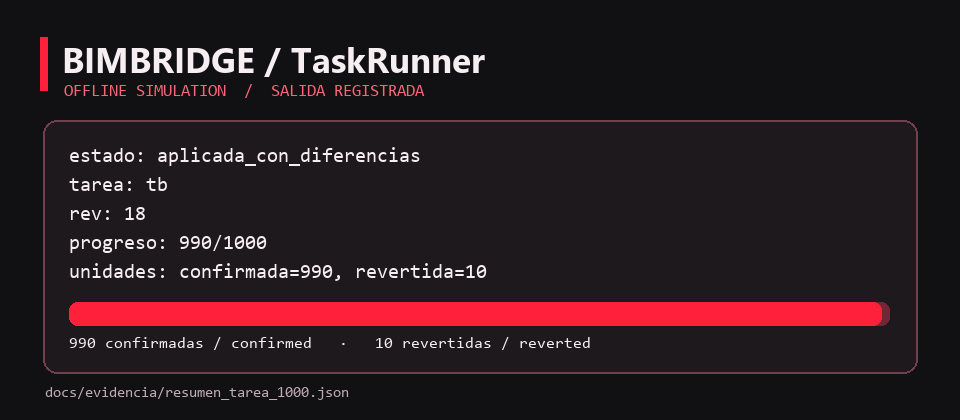
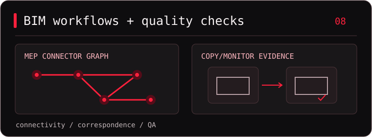
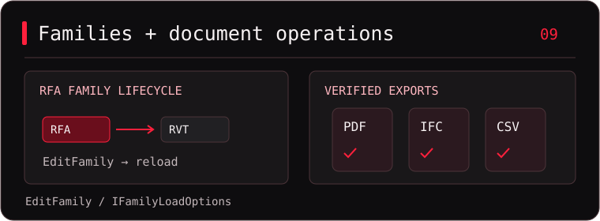

# BIMBRIDGE · Power Engine

**Motor local de automatización BIM con agentes para Autodesk Revit.** BIMBRIDGE conecta clientes MCP con la API de Revit mediante stdio y canales con nombre de Windows. El complemento C# despacha operaciones al hilo principal mediante `ExternalEvent`, mientras Power Engine prepara geometría, datos documentales y planes tipados fuera de Revit.

[English](README.md) · [Instalación](docs/getting-started/INSTALLATION.md) · [Conectar un cliente](docs/integrations/MCP.md) · [Ejemplos](examples/README.md) · [Documentación](docs/INDEX.md)

## Descarga BIMBRIDGE para Windows

**[Descargar el instalador más reciente](https://github.com/Jimjo2n/bimbridge-power-engine/releases/latest)** · [Notas y SHA-256](https://github.com/Jimjo2n/bimbridge-power-engine/releases/tag/v0.9.3) · [Todas las versiones](https://github.com/Jimjo2n/bimbridge-power-engine/releases) · [Matriz completa de herramientas](docs/MATRIZ_CAPACIDADES.md)

| Objetivos de compilación | Runtime del complemento |
| --- | --- |
| Revit 2022–2024 | .NET Framework 4.8 |
| Revit 2025–2026 | .NET 8 |
| Revit 2027 | .NET 10 |

1. Cierra Revit, descarga el paquete revisado y verifica su SHA-256. Selecciona las versiones y el cliente en el instalador. Consulta la [guía de instalación](docs/getting-started/INSTALLATION.md).
2. Conecta **Codex** o **Claude Code**, o configura el puente MCP por stdio en tu cliente. Los perfiles compacto y completo exponen contratos distintos. Consulta la [integración MCP](docs/integrations/MCP.md) y los contratos [compacto](docs/ESQUEMA_HERRAMIENTAS_compacto.json) y [completo](docs/ESQUEMA_HERRAMIENTAS_completo.json).
3. Abre un modelo de prueba autorizado. En la herramienta de lectura del perfil compacto, usa `ctx` para identificar el documento y luego `q LF f=id,type digest=true` para obtener una huella del conjunto filtrado de luminarias. Consulta los [ejemplos](examples/README.md) y las [recetas](docs/RECETAS.md).

## BIMBRIDGE de un vistazo

| Flujo de trabajo | Puntos de entrada | Resultados |
| --- | --- | --- |
| Inspección del modelo | `ctx`, `cat`, `q`, `get`, `geo` | Identificadores de documentos, campos de elementos, conteos, geometría y huellas. |
| Modelado y documentación | `plan`, `commit`, `fam`, `doc` | Cambios tipados, edición de familias, láminas, tablas y exportaciones PDF/IFC/CSV. |
| Coordinación y auditoría | `chk lighting_audit`, `chk model_health`, `chk copy_monitor` | Hallazgos, inventario de vínculos y evidencia de verificación. |
| Automatización de varios pasos | `tarea iniciar`, `tarea reanudar`, `tarea reconciliar`, `exec` | Ejecución reanudable, decisiones de recuperación y extensiones en C# dinámico. |
| Procesamiento de entradas externas | `power cap`, `pdf_grids`, `pdf_symbols`, `docx_extract` | Descubrimiento de capacidades y datos estructurados para geometría, registro y colocación. |

[Referencia de comandos y suboperaciones](docs/MATRIZ_CAPACIDADES.md) · [Recetas de trabajo](docs/RECETAS.md) · [Reproducir benchmarks](docs/performance/BENCHMARKS.md)

## Novedades

- **v0.9.3 experimental** incorporó Revit 2027 al instalador y a la compilación y completó 39 comprobaciones de paridad bajo criterios offline. Mejoró la colocación de luminarias, la geometría de vínculos, las anotaciones, los conjuntos de impresión y el manejo de PDF y hojas de cálculo. [Versión publicada](https://github.com/Jimjo2n/bimbridge-power-engine/releases/tag/v0.9.3)
- **Desarrollo** reúne los cambios entregados y próximos pasos en el [historial de cambios](CHANGELOG.md) y el [roadmap](docs/roadmap/BACKLOG.md).

## Evidencia verificable

| Evidencia | Alcance |
| --- | --- |
| Validación local v0.9.3 | La versión publicada reporta 822 pruebas .NET, 13 Rust y 33 Python aprobadas, con dos omitidas, además de una instalación aislada comprobada para el objetivo 2027. |
| Controles automáticos | [Distribución Windows](https://github.com/Jimjo2n/bimbridge-power-engine/actions/workflows/ci.yml), [contratos de workers](https://github.com/Jimjo2n/bimbridge-power-engine/actions/workflows/workers.yml) y [revisión del repositorio](https://github.com/Jimjo2n/bimbridge-power-engine/actions/workflows/repository.yml). |
| Aceptación en Revit y rendimiento | [Registros de validación](docs/quality/VALIDATION.md), [procedimiento de aceptación nativa](docs/0.9.0/NATIVE_VALIDATION.md) y [metodología de benchmarks](docs/performance/BENCHMARKS.md). La campaña nativa de v0.9.3 sigue pendiente. |

*Salida registrada de una prueba simulada de 1.000 unidades. La imagen reproduce campos seleccionados de la salida guardada.* [Consultar el JSON original](docs/evidencia/resumen_tarea_1000.json)

## Catálogo técnico

Las fichas describen contratos, componentes y operaciones del repositorio. Los valores y las relaciones dibujadas son ilustrativos.

[Transporte MCP y despacho en Revit](#01-transporte-mcp-y-despacho-en-revit) · [Consultas, snapshots y cursores](#02-consultas-snapshots-y-cursores) · [Planes tipados, transacciones y recuperación](#03-planes-tipados-transacciones-y-recuperación) · [Tareas reanudables y recibos](#04-tareas-reanudables-y-recibos) · [C# dinámico, Roslyn y utilidades BIM](#05-c-dinámico-roslyn-y-utilidades-bim) · [Despacho de Power Engine y workers](#06-despacho-de-power-engine-y-workers) · [Registro PDF–Revit y verificación](#07-registro-pdfrevit-y-verificación) · [Flujos BIM, MEP y control de calidad](#08-flujos-bim-mep-y-control-de-calidad) · [Familias, documentos y exportación](#09-familias-documentos-y-exportación) · [Identidad, permisos y observabilidad](#10-identidad-permisos-y-observabilidad) · [Compilación, pruebas y distribución](#11-compilación-pruebas-y-distribución)

### 01. Transporte MCP y despacho en Revit

`Bimbridge.Bridge` expone MCP por stdio y traduce las solicitudes a un protocolo local sobre canales con nombre de Windows. `Bimbridge.Addin` encola el acceso a la API y lo despacha en el hilo principal mediante `ExternalEvent`. `Bimbridge.Protocol` reúne los contratos compartidos. [Referencia técnica](docs/integrations/MCP.md)

### 02. Consultas, snapshots y cursores

`ctx`, `cat`, `q`, `get` y `geo` exponen contexto, catálogo, elementos y geometría de un documento. `QuerySnapshotStore` materializa filas para paginarlas en memoria. Vincula el cursor a sesión, documento y revisión, con TTL y expulsión LRU por presupuesto de memoria. [Referencia técnica](docs/0.9.0/CONSOLIDATED_DELIVERY_REPORT.md)

### 03. Planes tipados, transacciones y recuperación

`plan` prepara un diff y `commit` aplica las operaciones revisadas mediante `PlanApplier`. Las operaciones abarcan parámetros, elementos arquitectónicos y MEP, anotación y láminas. El motor comprueba conflictos, registra la intención de escritura y conserva evidencia para reconciliar un resultado incierto. [Referencia técnica](docs/PROJECT_OVERVIEW.md)

### 04. Tareas reanudables y recibos

`TaskRunner` divide tareas largas en unidades, conserva su estado y coordina barreras como guardar, sincronizar y exportar. La reanudación usa el estado persistido y la reconciliación registra una decisión explícita. `WorkflowReceipt` aporta evidencia de ejecución y verificación en los flujos que lo usan. [Referencia técnica](docs/MATRIZ_CAPACIDADES.md)

### 05. C# dinámico, Roslyn y utilidades BIM

`exec` ofrece consulta y ejecución de C# con modalidades transaccionales. `CompileCache` coordina solicitudes concurrentes con la misma clave mediante single-flight. `Bimbridge.Scripting` reúne utilidades `Bim.*` para montaje, visibilidad, grupos y control por manifiesto. [Referencia técnica](docs/0.9.0/DYNAMIC_CODE_EXECUTION_POLICY.md)

### 06. Despacho de Power Engine y workers

`PowerEngineDispatcher` selecciona kernels C# y operaciones geométricas Rust por FFI o IPC. El proceso Python extrae información de PDF, DOCX y hojas de cálculo. El contrato `pe=1` usa JSON por línea, negociación de capacidades, correlación y límites por trabajo. Las barras de la ficha ilustran campos de telemetría, sin representar mediciones. [Referencia técnica](docs/0.9.0/POWER_ENGINE_ARCHITECTURE.md)

### 07. Registro PDF–Revit y verificación

`pdf_grids` y `pdf_symbols` extraen ejes y candidatos en coordenadas de página. El registro empareja anclas nombradas y ajusta una transformación de semejanza o afín, con controles de residuos y escala. `PlacementVerifier` compara la colocación con evidencia independiente y clasifica discrepancias. [Referencia técnica](docs/0.9.0/POWER_ENGINE_ARCHITECTURE.md)

### 08. Flujos BIM, MEP y control de calidad

`MepNetwork` distingue proximidad, continuidad geométrica y conexión física mediante conectores. `RiserGraph`, `GroupVariants` y `AnnotationLayout` cubren grafos de montantes, firmas de variantes y composición de anotaciones. `chk copy_monitor` inventaría vínculos, prepara el traspaso y verifica correspondencias. `chk model_health` agrupa avisos y otras señales de salud. [Referencia técnica](docs/MATRIZ_CAPACIDADES.md)

### 09. Familias, documentos y exportación

`fam` cubre inspección de tipos, parámetros y conectores, indexación de RFA, edición con `EditFamily` y recarga con `IFamilyLoadOptions`. `doc` reúne `Save`, `SaveAs`, sincronización con central y exportación PDF, IFC y CSV, con comprobaciones específicas para cada salida. [Referencia técnica](docs/MATRIZ_CAPACIDADES.md)

### 10. Identidad, permisos y observabilidad

El principal de Windows y el transporte local forman parte del límite de confianza. Las sesiones y los alias aportan contexto de cliente, y los permisos distinguen lectura, modificación, exportación y C# dinámico. El historial operativo y los identificadores de correlación permiten seguir solicitudes y resultados en los componentes que los emiten. [Referencia técnica](docs/security/TRUST_MODEL.md)

### 11. Compilación, pruebas y distribución

`build.ps1` genera objetivos para Revit 2022–2027, con .NET Framework 4.8 para 2022–2024, .NET 8 para 2025–2026 y .NET 10 para 2027. GitHub Actions comprueba repositorio, workers y distribución Windows. `Setup` y `Setup.Core` verifican el manifiesto y los hashes y gestionan instalación y reversión. [Referencia técnica](docs/DEVELOPMENT.md)

## Mapa del repositorio

| Ruta | Contenido |
| --- | --- |
| [`src/`](src) | Complemento, puente MCP, contratos, motor, AgentHost, scripting e instalador. |
| [`native/`](native/power_engine) y [`workers/`](workers/python) | Motor geométrico Rust y proceso documental Python. |
| [`tests/`](tests) y [`benchmarks/`](benchmarks) | Pruebas de contratos y regresión, simulación y mediciones reproducibles. |
| [`tools/`](tools) y [`.github/`](.github) | Arneses de aceptación, verificación, empaquetado, controles CI y releases. |
| [`docs/`](docs/INDEX.md) y [`examples/`](examples) | Arquitectura, decisiones, recetas, evidencia y guías de integración. |

## Evidencia y mantenimiento

| Para… | Consulta |
| --- | --- |
| Revisar qué se ha probado | [Validación](docs/quality/VALIDATION.md) · [Controles de GitHub](docs/quality/CI.md) |
| Evaluar el rendimiento | [Mediciones y metodología](docs/performance/BENCHMARKS.md) |
| Seguir el desarrollo | [Roadmap](docs/roadmap/BACKLOG.md) · [Estado del desarrollo](DEVELOPMENT_STATE.md) |
| Consultar el origen del código | [Registro de procedencia](docs/REPOSITORY_SETUP.md) |
| Contribuir o reportar un problema | [Contribuciones](CONTRIBUTING.md) · [Reportes de seguridad](SECURITY.md) |

Mantenedor [Jose Jimenez](https://github.com/Jimjo2n). Código propio bajo [GPL-3.0-only](LICENSE). Consulta los [avisos de terceros](THIRD_PARTY_NOTICES.md).
