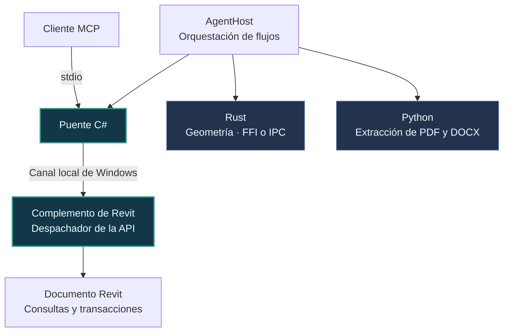
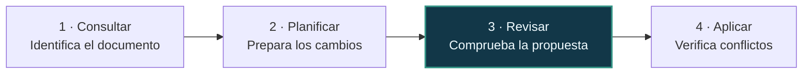

# BIMBRIDGE · Power Engine

**Automatización BIM local e integración con IA para Autodesk Revit.** Conecta un cliente MCP para consultar modelos, revisar cambios propuestos y ejecutar flujos de trabajo de Revit desde Windows.

[English](README.md) · [Instalación](docs/getting-started/INSTALLATION.md) · [Conectar un cliente](docs/integrations/MCP.md) · [Ejemplos](examples/README.md) · [Documentación](docs/INDEX.md)

> [!NOTE]
> **Versiones experimentales.** El código se compila para Revit 2022–2026. Consulta el registro de validación para saber qué operaciones y entornos se han probado.
> [Versiones](https://github.com/Jimjo2n/bimbridge-power-engine/releases) · [Validación](docs/quality/VALIDATION.md)

## Qué puedes hacer

| Consultar el modelo | Revisar y aplicar cambios | Procesar documentos y geometría |
| --- | --- | --- |
| Filtra elementos, cuenta luminarias y obtén resúmenes compactos. | Prepara un plan tipado, inspecciona sus cambios y aplícalo con controles de conflictos. | Extrae datos de PDF y DOCX con Python y ejecuta operaciones de geometría con Rust. |

## Cómo se conecta

[Arquitectura y componentes](docs/PROJECT_OVERVIEW.md) · [Modelo de confianza](docs/security/TRUST_MODEL.md)

## De una consulta a un cambio revisado

Empieza con una consulta de solo lectura. En el perfil compacto de MCP, `q LF n=true` solicita un conteo de luminarias. Para escribir en el modelo, sigue las [recetas de planificación y aplicación](docs/RECETAS.md).

> [!IMPORTANT]
> El C# dinámico se ejecuta con los privilegios del usuario de Revit. Consulta el [modelo de confianza](docs/security/TRUST_MODEL.md) para conocer los controles de ejecución y los límites de las transacciones.

## Primeros pasos

1. **Instala en Windows.** Sigue la [guía de instalación](docs/getting-started/INSTALLATION.md) y revisa el estado del paquete elegido.
2. **Conecta tu cliente MCP.** Sigue la [guía de integración](docs/integrations/MCP.md) y prueba una consulta con los [ejemplos](examples/README.md).
3. **Compila desde el código fuente.** Consulta los [requisitos y comandos](docs/DEVELOPMENT.md). Los objetivos de Revit 2022–2024 usan .NET Framework 4.8 y los de 2025–2026 usan .NET 8.

## Evidencia y mantenimiento

| Para… | Consulta |
| --- | --- |
| Revisar qué se ha probado | [Validación](docs/quality/VALIDATION.md) · [Controles de GitHub](docs/quality/CI.md) |
| Evaluar el rendimiento | [Mediciones y metodología](docs/performance/BENCHMARKS.md) |
| Seguir el desarrollo | [Roadmap](docs/roadmap/BACKLOG.md) · [Estado del desarrollo](DEVELOPMENT_STATE.md) |
| Consultar el origen del código | [Registro de procedencia](docs/REPOSITORY_SETUP.md) |
| Contribuir o reportar un problema | [Contribuciones](CONTRIBUTING.md) · [Reportes de seguridad](SECURITY.md) |

Mantenedor [Jose Jimenez](https://github.com/Jimjo2n). Código propio bajo [GPL-3.0-only](LICENSE). Consulta los [avisos de terceros](THIRD_PARTY_NOTICES.md).
