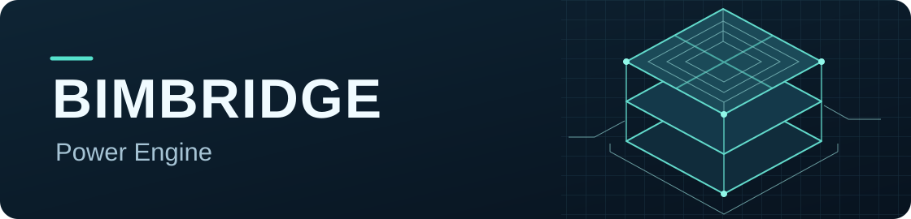
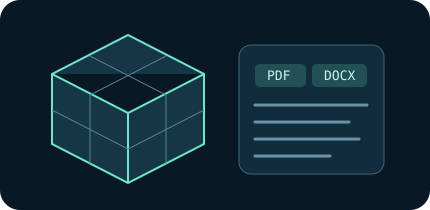

# BIMBRIDGE · Power Engine

**Automatización BIM local e integración con IA para Autodesk Revit.** Conecta un cliente MCP para consultar modelos, revisar cambios propuestos y ejecutar flujos de trabajo de Revit desde Windows.

[English](README.md) · [Instalación](docs/getting-started/INSTALLATION.md) · [Conectar un cliente](docs/integrations/MCP.md) · [Ejemplos](examples/README.md) · [Documentación](docs/INDEX.md)

> [!NOTE]
> **Versiones experimentales.** El código se compila para Revit 2022–2026. Consulta el registro de validación para saber qué operaciones y entornos se han probado.
> [Versiones](https://github.com/Jimjo2n/bimbridge-power-engine/releases) · [Validación](docs/quality/VALIDATION.md)

## BIMBRIDGE en acción

Las ilustraciones usan datos de ejemplo. BIMBRIDGE se ejecuta en tu equipo Windows. El cliente MCP envía solicitudes a un puente local en C# y el complemento realiza las operaciones del modelo mediante la API de Revit.

### 01 · Consulta el modelo

Envía `q LF n=true` desde el perfil compacto de MCP para contar luminarias. BIMBRIDGE lee el documento de Revit seleccionado y devuelve el total. También puedes filtrar elementos y pedir resultados compactos. Esta consulta deja intactos los elementos del modelo.

### 02 · Revisa un cambio antes de aplicarlo

Selecciona el documento y prepara un plan tipado. El plan te permite inspeccionar qué cambiaría, por ejemplo el parámetro **Marca** de una luminaria. Una vez revisado, aplica el plan. BIMBRIDGE comprueba conflictos y ejecuta los cambios en una transacción de Revit. Consulta las [recetas de planificación y aplicación](docs/RECETAS.md).

### 03 · Procesa geometría y documentos

El orquestador de flujos puede usar Rust para operaciones de geometría y Python para extraer contenido estructurado de PDF y DOCX. El complemento en C# se encarga del acceso al modelo de Revit. Consulta el [resumen de componentes](docs/PROJECT_OVERVIEW.md).

> [!IMPORTANT]
> El C# dinámico se ejecuta con los privilegios del usuario de Revit. Consulta el [modelo de confianza](docs/security/TRUST_MODEL.md) para conocer los controles de ejecución y los límites de las transacciones.

## Primeros pasos

1. **Instala en Windows.** Sigue la [guía de instalación](docs/getting-started/INSTALLATION.md) y revisa el estado del paquete elegido.
2. **Conecta tu cliente MCP.** Sigue la [guía de integración](docs/integrations/MCP.md) y prueba una consulta con los [ejemplos](examples/README.md).
3. **Compila desde el código fuente.** Consulta los [requisitos y comandos](docs/DEVELOPMENT.md). Los objetivos de Revit 2022–2024 usan .NET Framework 4.8 y los de 2025–2026 usan .NET 8.

## Evidencia y mantenimiento

| Para… | Consulta |
| --- | --- |
| Revisar qué se ha probado | [Validación](docs/quality/VALIDATION.md) · [Controles de GitHub](docs/quality/CI.md) |
| Evaluar el rendimiento | [Mediciones y metodología](docs/performance/BENCHMARKS.md) |
| Seguir el desarrollo | [Roadmap](docs/roadmap/BACKLOG.md) · [Estado del desarrollo](DEVELOPMENT_STATE.md) |
| Consultar el origen del código | [Registro de procedencia](docs/REPOSITORY_SETUP.md) |
| Contribuir o reportar un problema | [Contribuciones](CONTRIBUTING.md) · [Reportes de seguridad](SECURITY.md) |

Mantenedor [Jose Jimenez](https://github.com/Jimjo2n). Código propio bajo [GPL-3.0-only](LICENSE). Consulta los [avisos de terceros](THIRD_PARTY_NOTICES.md).
