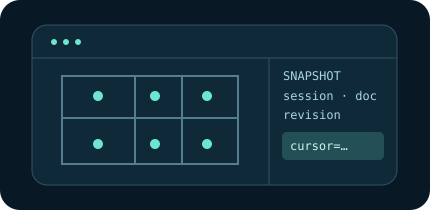
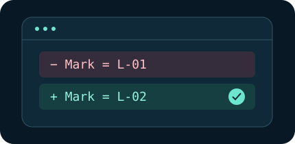
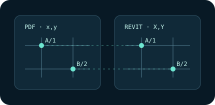

# BIMBRIDGE · Power Engine

**Motor local de automatización BIM con agentes para Autodesk Revit.** BIMBRIDGE conecta clientes MCP con la API de Revit mediante stdio y canales con nombre de Windows. El complemento C# despacha operaciones al hilo principal mediante `ExternalEvent`, mientras Power Engine prepara geometría, datos documentales y planes tipados fuera de Revit.

[English](README.md) · [Instalación](docs/getting-started/INSTALLATION.md) · [Conectar un cliente](docs/integrations/MCP.md) · [Ejemplos](examples/README.md) · [Documentación](docs/INDEX.md)

## Arquitectura en acción

### 01 · Snapshots de consulta vinculados a revisión

`QuerySnapshotStore` materializa las filas de una consulta una vez y sirve las páginas siguientes desde memoria. Cada cursor queda vinculado a sesión, documento y revisión. La retención combina caducidad por TTL y presupuesto de memoria con expulsión LRU. El puente y AgentHost transportan el cursor entre solicitudes y conservan el resultado consultado a nivel de fila. [Implementación y verificación](docs/0.9.0/CONSOLIDATED_DELIVERY_REPORT.md)

### 02 · Escrituras transaccionales con recuperación durable

`plan` y `commit` separan la preparación del cambio de su ejecución. El complemento aplica operaciones revisadas dentro de transacciones de Revit, comprueba conflictos y registra la intención de escritura antes de ejecutar. Los resultados inciertos pasan por reconciliación. El C# dinámico usa una caché de compilación Roslyn con coordinación single-flight para compartir la compilación entre solicitudes concurrentes con la misma clave. [Arquitectura y recuperación](docs/PROJECT_OVERVIEW.md) · [Verificación de la caché Roslyn](docs/0.9.0/CONSOLIDATED_DELIVERY_REPORT.md)

### 03 · Geometría nativa y procesamiento documental

`PowerEngineDispatcher` selecciona kernels C# u operaciones Rust como búsqueda de vecinos, emparejamiento y detección de contactos entre segmentos. Rust puede ejecutarse por FFI o IPC. Python extrae datos de PDF y DOCX en un proceso aparte. El contrato versionado `pe=1` usa JSON por línea, negociación de capacidades, correlación y límites por trabajo. La telemetría registra por separado los tiempos del motor, IPC, serialización y total. [Arquitectura y protocolo](docs/0.9.0/POWER_ENGINE_ARCHITECTURE.md)

### 04 · Registro PDF–modelo y verificación independiente

Python extrae intersecciones de ejes y candidatos a símbolos en coordenadas de página. C# empareja anclas por nombre, ajusta una transformación de semejanza o afín, comprueba residuos y escala, y traduce la colocación a operaciones tipadas. `PlacementVerifier` compara contra evidencia independiente y reporta discrepancias de posición, tipo, giro, altura y duplicados. [Registro y verificación](docs/0.9.0/POWER_ENGINE_ARCHITECTURE.md)

## Evidencia y mantenimiento

| Para… | Consulta |
| --- | --- |
| Revisar qué se ha probado | [Validación](docs/quality/VALIDATION.md) · [Controles de GitHub](docs/quality/CI.md) |
| Evaluar el rendimiento | [Mediciones y metodología](docs/performance/BENCHMARKS.md) |
| Seguir el desarrollo | [Roadmap](docs/roadmap/BACKLOG.md) · [Estado del desarrollo](DEVELOPMENT_STATE.md) |
| Consultar el origen del código | [Registro de procedencia](docs/REPOSITORY_SETUP.md) |
| Contribuir o reportar un problema | [Contribuciones](CONTRIBUTING.md) · [Reportes de seguridad](SECURITY.md) |

Mantenedor [Jose Jimenez](https://github.com/Jimjo2n). Código propio bajo [GPL-3.0-only](LICENSE). Consulta los [avisos de terceros](THIRD_PARTY_NOTICES.md).
