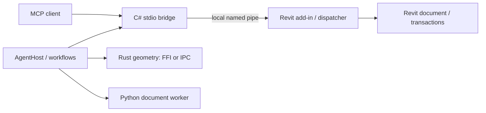

# BIMBRIDGE – Power Engine

Local BIM automation and AI-agent integration for Autodesk Revit, built with C#/.NET, Rust and Python.

BIMBRIDGE connects MCP clients to the Revit API through a local bridge and add-in. It provides declarative queries, typed modification plans, dynamic C# execution, durable recovery records and specialized geometry/document processing.

**Development candidate: 0.9.0+commit. Native acceptance is partial. This repository is initially private and has no stable release.**

[Español](README.es.md) · [Documentation](docs/INDEX.md) · [Build](docs/DEVELOPMENT.md) · [Security](docs/security/TRUST_MODEL.md) · [Contribute](CONTRIBUTING.md)



## Capabilities

- Per-client sessions, declared agent aliases and Windows-principal access boundaries.
- Model queries, compact results, canonical digests and timing.
- Typed plans, conflict checks, transactional trials and commits.
- Dynamic C# execution with a persistent blocking control.
- Durable write intent, uncertain-outcome detection and reconciliation.
- Rust geometry operations; Python PDF/DOCX extraction.
- Windows installation, backup, recovery and operational status views.

Dynamic C# is enabled by default for authorized local agents. It executes with the user's privileges and **is not a sandbox**. See the [trust model](docs/security/TRUST_MODEL.md).

## Compatibility and build

Source build targets Revit 2022–2026. The add-in uses .NET Framework 4.8 for 2022–2024 and .NET 8 for 2025–2026. Revit 2024.3 is the environment named in the supplied partial native report; support targets are not equivalent to complete native acceptance.

A full Windows build requires the .NET 8 SDK, .NET Framework targeting support, Rust x64, Git, a real CPython executable and package restore access or populated caches.

```powershell
./build.ps1 -Python C:/path/to/python.exe
```

This existing script builds and tests the distribution under ignored `dist/`; it does not install the add-in. Installation requires a reviewed Windows package and closed Revit instances. No installer from the incoming audit package is distributed through this repository. See [build and installation](docs/DEVELOPMENT.md).

## Usage

Connect an MCP-compatible client using the bridge configuration described in [client integration](docs/integrations/MCP.md). A compact-profile query such as:

```text
q LF n=true
```

requests a lighting-fixture count. Tool names depend on the configured MCP profile. Before writes, fix the target document, inspect the proposed diff and use the appropriate typed plan/commit workflow. See [recipes](docs/RECETAS.md).

## Evidence and limitations

The verified input delivery is `0.9.0+a291cc6`. Its source archive matches its Git bundle. Original history remains privately archived; this repository contains a sanitized import with an explicit [provenance record](docs/REPOSITORY_SETUP.md).

The delivery reports 610 C# tests, 13 Rust tests and 29 Python passes with 2 skips. Those are **delivery-reported results**, not a claim about every later commit. Current validation is tracked in [quality](docs/quality/VALIDATION.md).

Reported A/B medians include approximately 1.90× for grouped reads and 1.32× for a five-operation single-trip batch. Complete paginated reads were approximately 6.1× slower. Digest output is not equivalent to returning every row. A general 3–5× speedup is **not established**. See [methodology and results](docs/performance/BENCHMARKS.md).

Known work includes the long-operation session timeout, paginated-read regression, partial native acceptance and incomplete visual validation of the status panel. See [backlog](docs/roadmap/BACKLOG.md).

## Maintenance

Maintainer: Jose Jimenez ([Jimjo2n](https://github.com/Jimjo2n)). Report reproducible defects through issues using synthetic or sanitized data. Report vulnerabilities privately as described in [SECURITY.md](SECURITY.md). Contributions follow [CONTRIBUTING.md](CONTRIBUTING.md).

Original code: **GPL-3.0-only**. See [LICENSE](LICENSE), [license guide](docs/LICENSING.md) and [third-party notices](THIRD_PARTY_NOTICES.md). Autodesk reference binaries, credentials, live models and private audit logs are excluded.
