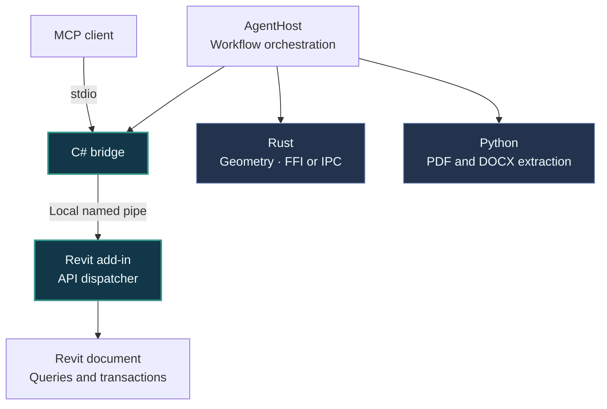
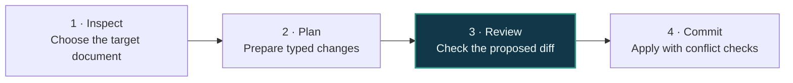

# BIMBRIDGE · Power Engine

**Local BIM automation and AI integration for Autodesk Revit.** Connect an MCP client to inspect models, review proposed changes, and run Revit workflows from your Windows workstation.

[Español](README.es.md) · [Installation](docs/getting-started/INSTALLATION.md) · [Connect a client](docs/integrations/MCP.md) · [Examples](examples/README.md) · [Documentation](docs/INDEX.md)

> [!NOTE]
> **Experimental releases.** The source targets Revit 2022–2026. Consult the validation record for the operations and Revit environments tested.
> [Releases](https://github.com/Jimjo2n/bimbridge-power-engine/releases) · [Validation](docs/quality/VALIDATION.md)

## What you can do

| Inspect a model | Review and apply changes | Process documents and geometry |
| --- | --- | --- |
| Query elements, filter results, count fixtures and retrieve compact summaries. | Prepare a typed plan, inspect its proposed changes and apply it with conflict checks. | Extract data from PDFs and DOCX files in Python and run dedicated geometry operations in Rust. |

## How it connects

[Architecture and component responsibilities](docs/PROJECT_OVERVIEW.md) · [Trust model](docs/security/TRUST_MODEL.md)

## From a query to a reviewed change

Start with a read-only request. In the compact MCP profile, `q LF n=true` requests a lighting fixture count. For writes, follow the [plan and commit recipes](docs/RECETAS.md) and consult the [operations and recovery guides](docs/INDEX.md) if an outcome is uncertain.

> [!IMPORTANT]
> Dynamic C# runs with the Revit user's privileges. Use the [trust model](docs/security/TRUST_MODEL.md) to understand execution controls and the effects that Revit transactions can reverse.

## Get started

1. **Install on Windows.** Use the [installation guide](docs/getting-started/INSTALLATION.md) and review the status of the package you select.
2. **Connect your MCP client.** Follow the [integration guide](docs/integrations/MCP.md), then try a query with the [examples](examples/README.md).
3. **Build from source.** See [development and build](docs/DEVELOPMENT.md) for SDK requirements, the build command and test instructions. The Revit 2022–2024 targets use .NET Framework 4.8. The 2025–2026 targets use .NET 8.

## Project evidence and maintenance

| If you want to… | Start here |
| --- | --- |
| Review what has been tested | [Validation](docs/quality/VALIDATION.md) · [CI scope](docs/quality/CI.md) |
| Assess performance | [Benchmarks and methodology](docs/performance/BENCHMARKS.md) |
| Follow work in progress | [Roadmap](docs/roadmap/BACKLOG.md) · [Development state](DEVELOPMENT_STATE.md) |
| Understand the source history | [Repository provenance](docs/REPOSITORY_SETUP.md) |
| Contribute or report a problem | [Contributing](CONTRIBUTING.md) · [Security reporting](SECURITY.md) |

Maintained by [Jose Jimenez](https://github.com/Jimjo2n). First-party code is [GPL-3.0-only](LICENSE). See [third-party notices](THIRD_PARTY_NOTICES.md) for bundled components.
