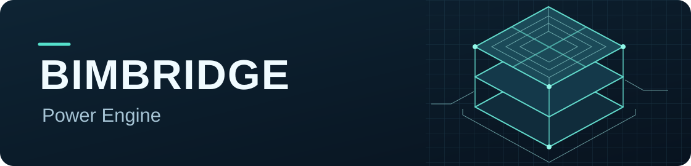
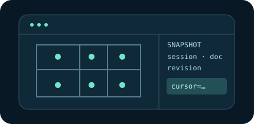
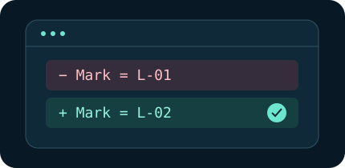
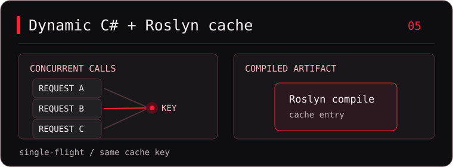
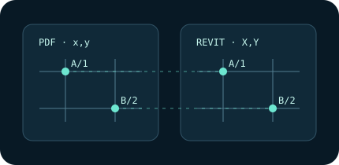
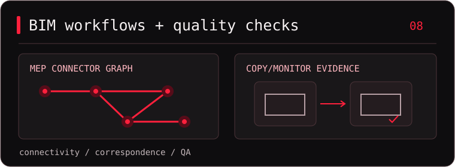
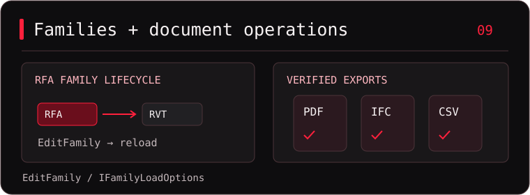
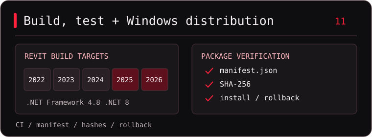

# BIMBRIDGE · Power Engine

**Local runtime for agent-driven BIM automation in Autodesk Revit.** BIMBRIDGE exposes the Revit API through MCP over stdio and Windows named pipes. Its C# add-in dispatches API work on Revit’s main thread through `ExternalEvent`, while Power Engine prepares geometry, document data and typed plans outside Revit.

[Español](README.es.md) · [Installation](docs/getting-started/INSTALLATION.md) · [Connect a client](docs/integrations/MCP.md) · [Examples](examples/README.md) · [Documentation](docs/INDEX.md)

## Download

[Windows installer and update ZIP](https://github.com/Jimjo2n/bimbridge-power-engine/releases) for Revit 2022–2027. The 0.9.3 prerelease passed offline validation. Native acceptance remains pending. [Self-QC](docs/0.9.2/SELF_QC_PARIDAD.md)

## Technical catalog

These plates describe the repository’s contracts, components and operations. Drawn values and relationships are illustrative.

[MCP transport and Revit dispatch](#01-mcp-transport-and-revit-dispatch) · [Queries, snapshots and cursors](#02-queries-snapshots-and-cursors) · [Typed plans, transactions and recovery](#03-typed-plans-transactions-and-recovery) · [Resumable tasks and receipts](#04-resumable-tasks-and-receipts) · [Dynamic C#, Roslyn and BIM helpers](#05-dynamic-c-roslyn-and-bim-helpers) · [Power Engine dispatch and workers](#06-power-engine-dispatch-and-workers) · [PDF–Revit registration and verification](#07-pdfrevit-registration-and-verification) · [BIM workflows, MEP and quality control](#08-bim-workflows-mep-and-quality-control) · [Families, documents and export](#09-families-documents-and-export) · [Identity, permissions and observability](#10-identity-permissions-and-observability) · [Build, testing and distribution](#11-build-testing-and-distribution)

### 01. MCP transport and Revit dispatch

`PDI.RevitMcp.Bridge` exposes MCP over stdio and translates requests into a local Windows named-pipe protocol. `PDI.RevitMcp.Addin` queues API access and dispatches it on Revit’s main thread through `ExternalEvent`. `PDI.RevitMcp.Protocol` holds the shared contracts. [Technical reference](docs/integrations/MCP.md)

### 02. Queries, snapshots and cursors

`ctx`, `cat`, `q`, `get` and `geo` expose document context, catalogs, elements and geometry. `QuerySnapshotStore` materializes rows for in-memory pagination. Cursors bind to session, document and revision, with TTL and LRU eviction under a memory budget. [Technical reference](docs/0.9.0/CONSOLIDATED_DELIVERY_REPORT.md)

### 03. Typed plans, transactions and recovery

`plan` prepares a diff and `commit` applies reviewed operations through `PlanApplier`. Typed operations cover parameters, architectural and MEP elements, annotation and sheets. The engine checks conflicts, records write intent and retains evidence for reconciling uncertain outcomes. [Technical reference](docs/PROJECT_OVERVIEW.md)

### 04. Resumable tasks and receipts

`TaskRunner` divides long tasks into units, persists their state and coordinates barriers such as save, sync and export. Resume uses stored state and reconciliation records an explicit decision. `WorkflowReceipt` captures execution and verification evidence in workflows that use it. [Technical reference](docs/MATRIZ_CAPACIDADES.md)

### 05. Dynamic C#, Roslyn and BIM helpers

`exec` exposes dynamic C# queries and execution with transaction modes. `CompileCache` coordinates concurrent requests for the same key with single-flight compilation. `PDI.RevitMcp.Scripting` provides `Bim.*` helpers for mounting, visibility, groups and manifest-based checks. [Technical reference](docs/0.9.0/DYNAMIC_CODE_EXECUTION_POLICY.md)

### 06. Power Engine dispatch and workers

`PowerEngineDispatcher` selects managed kernels and Rust geometry operations over FFI or IPC. The Python process extracts PDF, DOCX and workbook data. The `pe=1` contract uses JSON Lines, capability negotiation, correlation and job limits. The bars illustrate telemetry fields with sample lengths. [Technical reference](docs/0.9.0/POWER_ENGINE_ARCHITECTURE.md)

### 07. PDF–Revit registration and verification

`pdf_grids` and `pdf_symbols` extract grids and candidates in page coordinates. Registration matches named anchors and fits a similarity or affine transform with residual and scale checks. `PlacementVerifier` compares placement against independent evidence and classifies discrepancies. [Technical reference](docs/0.9.0/POWER_ENGINE_ARCHITECTURE.md)

### 08. BIM workflows, MEP and quality control

`MepNetwork` separates proximity, geometric continuity and physical connector links. `RiserGraph`, `GroupVariants` and `AnnotationLayout` cover riser graphs, variant signatures and annotation placement. `chk copy_monitor` inventories links, prepares the handoff and verifies correspondence. `chk model_health` groups warnings and other model-health signals. [Technical reference](docs/MATRIZ_CAPACIDADES.md)

### 09. Families, documents and export

`fam` covers type, parameter and connector inspection, RFA indexing, editing through `EditFamily` and reload through `IFamilyLoadOptions`. `doc` covers `Save`, `SaveAs`, central synchronization and PDF, IFC and CSV export, with output-specific verification. [Technical reference](docs/MATRIZ_CAPACIDADES.md)

### 10. Identity, permissions and observability

The Windows principal and local transport form part of the trust boundary. Sessions and aliases add client context, and permissions distinguish reading, modifying, exporting and running dynamic C#. Operation history and correlation identifiers help trace requests and outcomes where emitted. [Technical reference](docs/security/TRUST_MODEL.md)

### 11. Build, testing and distribution

`build.ps1` produces Revit 2022–2027 targets using .NET Framework 4.8 for 2022–2024, .NET 8 for 2025–2026 and .NET 10 for 2027. GitHub Actions checks repository hygiene, worker contracts and Windows distribution. `Setup` and `Setup.Core` validate the manifest and hashes and handle installation and rollback. [Technical reference](docs/DEVELOPMENT.md)

## Repository map

| Path | Contents |
| --- | --- |
| [`src/`](src) | Add-in, MCP bridge, contracts, engine, AgentHost, scripting and setup. |
| [`native/`](native/power_engine) + [`workers/`](workers/python) | Rust geometry engine and Python document worker. |
| [`tests/`](tests) + [`benchmarks/`](benchmarks) | Contract and regression tests, simulation and reproducible measurements. |
| [`tools/`](tools) + [`.github/`](.github) | Acceptance harnesses, verification, packaging, CI and releases. |
| [`docs/`](docs/INDEX.md) + [`examples/`](examples) | Architecture, design decisions, recipes, evidence and integration guides. |

## Project evidence and maintenance

| If you want to… | Start here |
| --- | --- |
| Review what has been tested | [Validation](docs/quality/VALIDATION.md) · [CI scope](docs/quality/CI.md) |
| Assess performance | [Benchmarks and methodology](docs/performance/BENCHMARKS.md) |
| Follow work in progress | [Roadmap](docs/roadmap/BACKLOG.md) · [Development state](DEVELOPMENT_STATE.md) |
| Understand the source history | [Repository provenance](docs/REPOSITORY_SETUP.md) |
| Contribute or report a problem | [Contributing](CONTRIBUTING.md) · [Security reporting](SECURITY.md) |

Maintained by [Jose Jimenez](https://github.com/Jimjo2n). First-party code is [GPL-3.0-only](LICENSE). See [third-party notices](THIRD_PARTY_NOTICES.md) for bundled components.
