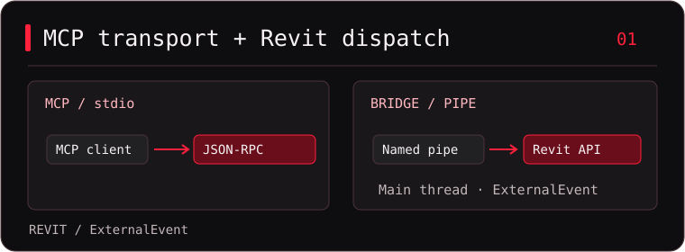
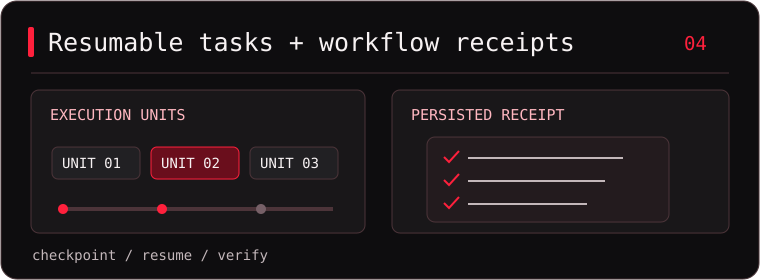
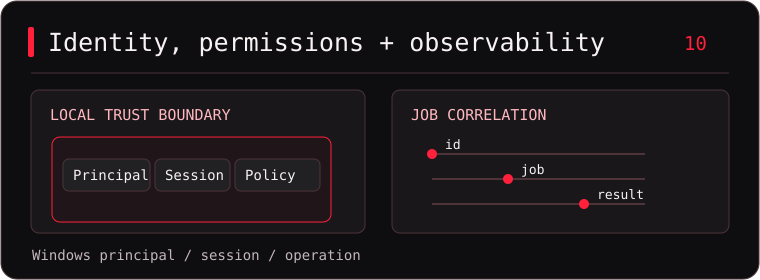

# BIMBRIDGE · Power Engine

**Local runtime for agent-driven BIM automation in Autodesk Revit.** BIMBRIDGE exposes the Revit API through MCP over stdio and Windows named pipes. Its C# add-in dispatches API work on Revit’s main thread through `ExternalEvent`, while Power Engine prepares geometry, document data and typed plans outside Revit.

[Installation](docs/getting-started/INSTALLATION.md) · [Connect a client](docs/integrations/MCP.md) · [Examples](examples/README.md) · [Documentation](docs/INDEX.md)

## Get BIMBRIDGE for Windows

**[Download the latest Setup](https://github.com/Jimjo2n/bimbridge-power-engine/releases/latest)** · [Release notes and SHA-256](https://github.com/Jimjo2n/bimbridge-power-engine/releases/tag/v0.9.7) · [All releases](https://github.com/Jimjo2n/bimbridge-power-engine/releases) · [Full tool matrix](docs/CAPABILITY_MATRIX.md)

| Revit build targets | Add-in runtime |
| --- | --- |
| 2022–2024 | .NET Framework 4.8 |
| 2025–2026 | .NET 8 |
| 2027 | .NET 10 |

1. Close Revit, download the reviewed package and verify its SHA-256. Select your Revit releases and client in Setup. See the [installation guide](docs/getting-started/INSTALLATION.md).
2. Connect through **Codex** or **Claude Code**, or configure the MCP stdio bridge in your client. The bridge offers compact and complete profiles with separate tool schemas. See [MCP setup](docs/integrations/MCP.md) and the [compact](docs/TOOL_SCHEMA_compact.json) and [complete](docs/TOOL_SCHEMA_complete.json) contracts.
3. Open an authorized test model. In the compact read tool, use `ctx` to identify the document, then `q LF f=id,type digest=true` to request a fingerprint of the filtered lighting fixtures. See [command examples](examples/README.md) and [workflow recipes](docs/RECIPES.md).

**Updating from 0.9.x:** do it once by hand. Finish or cancel paused tasks, close Revit and double-click `Bimbridge.Setup.exe`; the 0.9.x Update button cannot find the renamed installer. Setup moves your data, settings, grants and client registrations to the new names. Afterwards, re-create Claude Code permission rules written for the previous MCP tool prefix as `mcp__bimbridge__*`, and re-assign Revit shortcuts and Quick Access Toolbar buttons. Later updates work from the ribbon again. See the [changelog](CHANGELOG.md).

## BIMBRIDGE at a glance

| Workflow | Entry points | Results |
| --- | --- | --- |
| Inspect a model | `ctx`, `cat`, `q`, `get`, `geo` | Document handles, element projections, counts, geometry and digests. |
| Model and document | `plan`, `commit`, `fam`, `doc` | Typed changes, family editing, sheets and schedules, PDF/IFC/CSV exports. |
| Coordinate and audit | `chk lighting_audit`, `chk model_health`, `chk copy_monitor` | Findings, linked-model inventory and verification evidence. |
| Automate multi-step work | `tarea iniciar`, `tarea reanudar`, `tarea reconciliar`, `exec` | Resumable execution, recovery decisions and dynamic C# extensions. |
| Process external inputs | `power cap`, `pdf_grids`, `pdf_symbols`, `docx_extract` | Capability discovery and structured data for geometry, registration and placement workflows. |

[Command and suboperation reference](docs/CAPABILITY_MATRIX.md) · [Workflow recipes](docs/RECIPES.md) · [Reproduce benchmarks](docs/performance/BENCHMARKS.md)

## Release news

- **v0.9.3 experimental** added the Revit 2027 build and installer target and completed the 39 parity checks under the offline criteria. It improved lighting placement, linked geometry, annotations, print sets, and PDF and workbook handling. [Published release](https://github.com/Jimjo2n/bimbridge-power-engine/releases/tag/v0.9.3)
- **Development** tracks upcoming work and shipped changes in the [changelog](CHANGELOG.md) and [roadmap](docs/roadmap/BACKLOG.md).

## Evidence you can inspect

| Evidence | What it covers |
| --- | --- |
| v0.9.3 local validation | Published release reports 822 .NET, 13 Rust and 33 Python tests passed, with two skipped, plus isolated installation verification for the 2027 target. |
| Automated checks | [Windows distribution](https://github.com/Jimjo2n/bimbridge-power-engine/actions/workflows/ci.yml), [worker contracts](https://github.com/Jimjo2n/bimbridge-power-engine/actions/workflows/workers.yml) and [repository checks](https://github.com/Jimjo2n/bimbridge-power-engine/actions/workflows/repository.yml). |
| Revit acceptance and benchmarks | [Validation records](docs/quality/VALIDATION.md), [native acceptance procedure](docs/0.9.0/NATIVE_VALIDATION.md) and [benchmark methodology](docs/performance/BENCHMARKS.md). The native campaign for v0.9.3 remains pending. |

*Recorded output from the 1,000-unit simulated task fixture. The visual reproduces selected fields from the checked-in output.* [Inspect the original JSON](docs/evidencia/resumen_tarea_1000.json)

## Technical catalog

These plates describe the repository’s contracts, components and operations. Drawn values and relationships are illustrative.

[MCP transport and Revit dispatch](#01-mcp-transport-and-revit-dispatch) · [Queries, snapshots and cursors](#02-queries-snapshots-and-cursors) · [Typed plans, transactions and recovery](#03-typed-plans-transactions-and-recovery) · [Resumable tasks and receipts](#04-resumable-tasks-and-receipts) · [Dynamic C#, Roslyn and BIM helpers](#05-dynamic-c-roslyn-and-bim-helpers) · [Power Engine dispatch and workers](#06-power-engine-dispatch-and-workers) · [PDF–Revit registration and verification](#07-pdfrevit-registration-and-verification) · [BIM workflows, MEP and quality control](#08-bim-workflows-mep-and-quality-control) · [Families, documents and export](#09-families-documents-and-export) · [Identity, permissions and observability](#10-identity-permissions-and-observability) · [Build, testing and distribution](#11-build-testing-and-distribution)

### 01. MCP transport and Revit dispatch

`Bimbridge.Bridge` exposes MCP over stdio and translates requests into a local Windows named-pipe protocol. `Bimbridge.Addin` queues API access and dispatches it on Revit’s main thread through `ExternalEvent`. `Bimbridge.Protocol` holds the shared contracts. [Technical reference](docs/integrations/MCP.md)

### 02. Queries, snapshots and cursors

`ctx`, `cat`, `q`, `get` and `geo` expose document context, catalogs, elements and geometry. `QuerySnapshotStore` materializes rows for in-memory pagination. Cursors bind to session, document and revision, with TTL and LRU eviction under a memory budget. [Technical reference](docs/0.9.0/CONSOLIDATED_DELIVERY_REPORT.md)

### 03. Typed plans, transactions and recovery

`plan` prepares a diff and `commit` applies reviewed operations through `PlanApplier`. Typed operations cover parameters, architectural and MEP elements, annotation and sheets. The engine checks conflicts, records write intent and retains evidence for reconciling uncertain outcomes. [Technical reference](docs/PROJECT_OVERVIEW.md)

### 04. Resumable tasks and receipts

`TaskRunner` divides long tasks into units, persists their state and coordinates barriers such as save, sync and export. Resume uses stored state and reconciliation records an explicit decision. `WorkflowReceipt` captures execution and verification evidence in workflows that use it. [Technical reference](docs/CAPABILITY_MATRIX.md)

### 05. Dynamic C#, Roslyn and BIM helpers

`exec` exposes dynamic C# queries and execution with transaction modes. `CompileCache` coordinates concurrent requests for the same key with single-flight compilation. `Bimbridge.Scripting` provides `Bim.*` helpers for mounting, visibility, groups and manifest-based checks. [Technical reference](docs/0.9.0/DYNAMIC_CODE_EXECUTION_POLICY.md)

### 06. Power Engine dispatch and workers

`PowerEngineDispatcher` selects managed kernels and Rust geometry operations over FFI or IPC. The Python process extracts PDF, DOCX and workbook data. The `pe=1` contract uses JSON Lines, capability negotiation, correlation and job limits. The bars illustrate telemetry fields with sample lengths. [Technical reference](docs/0.9.0/POWER_ENGINE_ARCHITECTURE.md)

### 07. PDF–Revit registration and verification

`pdf_grids` and `pdf_symbols` extract grids and candidates in page coordinates. Registration matches named anchors and fits a similarity or affine transform with residual and scale checks. `PlacementVerifier` compares placement against independent evidence and classifies discrepancies. [Technical reference](docs/0.9.0/POWER_ENGINE_ARCHITECTURE.md)

### 08. BIM workflows, MEP and quality control

`MepNetwork` separates proximity, geometric continuity and physical connector links. `RiserGraph`, `GroupVariants` and `AnnotationLayout` cover riser graphs, variant signatures and annotation placement. `chk copy_monitor` inventories links, prepares the handoff and verifies correspondence. `chk model_health` groups warnings and other model-health signals. [Technical reference](docs/CAPABILITY_MATRIX.md)

### 09. Families, documents and export

`fam` covers type, parameter and connector inspection, RFA indexing, editing through `EditFamily` and reload through `IFamilyLoadOptions`. `doc` covers `Save`, `SaveAs`, central synchronization and PDF, IFC and CSV export, with output-specific verification. [Technical reference](docs/CAPABILITY_MATRIX.md)

### 10. Identity, permissions and observability

The Windows principal and local transport form part of the trust boundary. Sessions and aliases add client context, and permissions distinguish reading, modifying, exporting and running dynamic C#. Operation history and correlation identifiers help trace requests and outcomes where emitted. [Technical reference](docs/security/TRUST_MODEL.md)

### 11. Build, testing and distribution

`build.ps1` produces Revit 2022–2027 targets using .NET Framework 4.8 for 2022–2024, .NET 8 for 2025–2026 and .NET 10 for 2027. GitHub Actions checks repository hygiene, worker contracts and Windows distribution. `Setup` and `Setup.Core` validate the manifest and hashes and handle installation and rollback. [Technical reference](docs/DEVELOPMENT.md)

## Repository map

| Path | Contents |
| --- | --- |
| [`src/`](src) | Add-in, MCP bridge, contracts, engine, AgentHost, scripting and setup. |
| [`native/`](native/power_engine) + [`workers/`](workers/python) | Rust geometry engine and Python document worker. |
| [`tests/`](tests) + [`benchmarks/`](benchmarks) | Contract and regression tests, simulation and reproducible measurements. |
| [`tools/`](tools) + [`.github/`](.github) | Acceptance harnesses, verification, packaging, CI and releases. |
| [`docs/`](docs/INDEX.md) + [`examples/`](examples) | Architecture, design decisions, recipes, evidence and integration guides. |

## Project evidence and maintenance

| If you want to… | Start here |
| --- | --- |
| Review what has been tested | [Validation](docs/quality/VALIDATION.md) · [CI scope](docs/quality/CI.md) |
| Assess performance | [Benchmarks and methodology](docs/performance/BENCHMARKS.md) |
| Follow work in progress | [Roadmap](docs/roadmap/BACKLOG.md) · [Development state](DEVELOPMENT_STATE.md) |
| Understand the source history | [Repository provenance](docs/REPOSITORY_SETUP.md) |
| Contribute or report a problem | [Contributing](CONTRIBUTING.md) · [Security reporting](SECURITY.md) |

Maintained by [Jose Jimenez](https://github.com/Jimjo2n). First-party code is [GPL-3.0-only](LICENSE). See [third-party notices](THIRD_PARTY_NOTICES.md) for bundled components.
